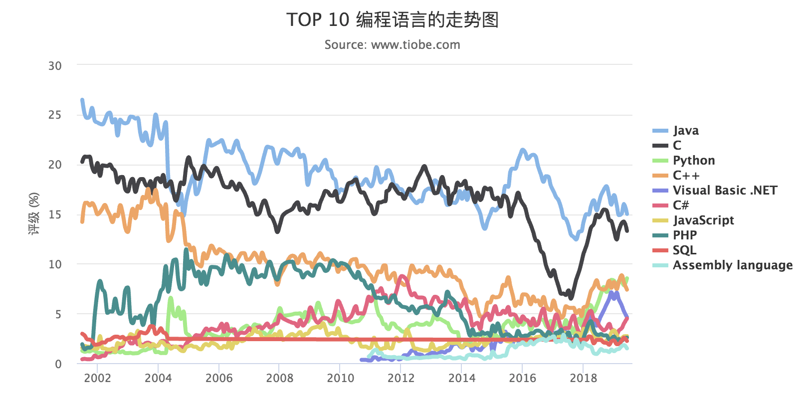

### Python is getting more and more popular

When Python was first created, it was not very powerful. It ran slowly, it could not use many CPU cores, and it could hardly do things at the same time. Back then, computers were not very fast, so Python did not become popular. Many people had never even heard of it.

Over time, computers got much faster, and software got much more complex. Companies started to care more about **how fast people can write code**. A new idea appeared: at the start of a project, speed of development matters more than speed of the program. It's not worth making the work many times bigger just to save less than 1 millisecond. In other words, the programmer's time matters more than the machine's time. So more and more developers started to love Python.

From 2012 to 2014, cloud computing became a hot topic. Lots of start-ups and big internet companies rushed into it. The most famous open-source cloud platform, OpenStack, was built with Python.

A few years later, artificial intelligence (AI) and machine learning became very popular – and Python was the first-choice language for them too.

By then, Python had become a focus of internet development. In the "Top 10 programming languages" trend chart, Python climbed to 3rd place, and in 2017 it became the most popular language.

Here is the trend from the TIOBE Programming Community Index, 2002 – 2018:

- **Java**: in 1st place for a long time. About 25% in 2002, dropping to about 15% in 2018.
- **C**: in the top 2 with Java for a long time. About 20% in 2002, about 14% in 2018.
- **Python**: only about 1% in 2002, rising to about 8% in 2018, into the Top 3.
- **C++, C#, JavaScript, PHP** and others: moving up and down between 5% and 10%.

> Source: [TIOBE Index](https://www.tiobe.com/tiobe-index/).

### Python developers earn good money

Python developers are some of the best-paid developers, especially in data science, machine learning and web development.

In China's biggest cities (Beijing, Shanghai, Guangzhou and Shenzhen), Python jobs pay over 20,000 yuan a month.

| City | AI | Big data algorithms | Python | Average pay |
| --- | ---: | ---: | ---: | ---: |
| Beijing | 39080 | 28400 | 19630 | 29036 |
| Shanghai | 34510 | 24240 | 16740 | 25163 |
| Guangzhou | 33190 | 21290 | 14630 | 23036 |
| Hangzhou | 15230 | 17270 | 11100 | 14533 |

> Source: aibbt.com (monthly pay in yuan).

### Python is easy to start and very powerful

If you are a beginner, Python is your best choice. It's easy to learn, it's powerful, and you can build web apps with it easily. It's a great first language.

Python has even been added to school exams and primary school textbooks in China.

> **"Internet-famous" AI language Python enters Shandong primary school textbooks**
>
> The Paper · Wang Xinxin · 11 Dec 2017
>
> Besides English, some high school and even primary school students may soon need to learn another "foreign language" – Python. Shandong Province recently added Python to its new Year 6 information technology textbook.
>
> Simply put, Python is a widely used, high-level, general-purpose programming language. It was created by Guido van Rossum from the Netherlands, and its first version came out in 1991. In ranked.com's list, Python was the most popular AI programming language in 2017, with C++ in second place.

If you already know some programming, Python is also a good choice. Python may well be the main direction for future development, and knowing one more language gives you one more useful skill. Python also has powerful libraries, so you can build tools very quickly to help with your main work.

## First, pick a small thing you want to make

After reading all that, you may want to start learning right away. But don't rush off to find more courses. Let's set a small goal first: **learn to track how much time you spend studying each day.**

Step one only needs to show one sentence on the screen. When you learn lists and dictionaries, you will put several study records together. When you learn loops, you will add up the total minutes. When you learn functions, you will turn these steps into code you can use again and again. Later, you will save it to a file and add tests. This way, after each part, you can see what problem it solved.

There are two ways to use this tutorial. If it's your first time, use the challenge pages and code along. If you want the big picture first, or want to look up an idea again, use the full reading pages. If you meet a word that isn't explained yet, write it down and where you saw it. If not knowing it stops you from understanding the example, go back to the earlier chapter. If you just want to know how it works inside, finish the exercise first and come back later.

The news and rankings above come from older sources. When you choose what to learn, also think about your own interests, what you really need, and what jobs ask for today. First finish a small task that is useful to you, then decide if you want to go deeper.

Now write down one clear note for yourself: what do you plan to finish today, and what result means you're done? When you finish studying, also write down one example you changed, one problem you met, and one thing to check next time. These help you keep learning much more than "how long I studied today".
